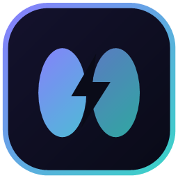

# Server Brain

**Run, watch and open all your local projects from one tiny Windows app.**
Node.js, Python, PHP, Docker or any custom command. Add a project once, then it starts with Windows, stays alive, warns you about port clashes and opens by name in your browser, and can even be shared publicly with one switch.

MIT licensed. It never modifies the projects it runs.

<p align="center"></p>

## Why it is light

| | |
|---|---|
| Idle tray process | about **25 MB** private memory, ~0 % CPU (it sleeps between 2–5 s heartbeats) |
| Dashboard window | WebView2 is created when you open the window and **destroyed when you close it** (frees ~500 MB of web-view processes) |
| Your projects | **On-demand** mode: a project uses *no* RAM or GPU until you open its address, and stops itself when idle |
| Boot | Always-on projects start **one by one** (staggered), not all at once |

## Features

**Run modes (per project)**
- **Manual** – you press Start; it runs until you stop it ("once").
- **Always on** – starts automatically with Windows and is restarted if it crashes (exponential back-off, give-up limit).
- **On demand** – opening `http://my-project.localhost` starts it (animated "waking up" page), and it stops after N idle minutes.

**Web address for every project** – `http://name.localhost` (no hosts-file editing; Chrome, Edge and Firefox resolve `*.localhost` themselves). WebSockets, streaming and large uploads work through the proxy.

**Port safety** – duplicate ports are flagged the moment you add a project and again before every start. If a port is taken you see *who* holds it (process name + PID) and can: stop that process (never a system process), move the project to a free port, or start anyway. A live *Ports* page shows everything listening on the PC.

**Process control** – the whole process tree is owned by a Windows Job Object: *Stop kills everything*, including grandchildren; if Server Brain itself dies nothing is left behind. Optional stop command (`docker compose down`), CPU priority, memory limit, startup dependencies, startup delay.

**Smart import** – point it at `D:\Local-AI-Studios` and it lists every runnable sub-folder with a recommended start command and port (read from `package.json`, `.env`, your start scripts, `docker-compose.yml`…). Detection is strictly read-only.

**Public access (Cloudflare Tunnel)** – one switch per project: a random `https://….trycloudflare.com` link (no account) or your own domain with a tunnel token. Visitors only ever reach that one project, never the dashboard, behind an **access-code page** by default. Tunnel tokens are stored encrypted (Windows DPAPI).

**Dashboard & tray** – animated dark/light UI with live CPU/RAM sparklines, logs with search and ANSI colour, activity timeline, command palette (`Ctrl K`), desktop notifications on crashes and conflicts. Same UI in the window and in any browser at `http://127.0.0.1:7777`.

**Also** – import/export of your configuration, crash log, single-instance, clean shutdown on logoff (runs stop commands), per-user install without admin rights.

**Dashboard address:** `http://127.0.0.1:7777` (also `http://brain.localhost`). Full guide: [docs/GUIDE.md](docs/GUIDE.md).

## Install

Download `ServerBrain-Setup-<version>.exe`, run it, tick *Start Server Brain when I sign in*. Uninstall from *Settings → Apps* (it asks whether to keep your settings).

Requirements: Windows 10 (1809+) or 11, x64. The Microsoft Edge WebView2 runtime ships with Windows 11 and current Windows 10; if it is missing the app opens the dashboard in your browser instead. Your own projects need their own runtimes (Node, Python, PHP…) on `PATH`, exactly as in a terminal.

## Using it

1. **Add projects** → *Scan a folder of projects* → pick the parent folder → tick the ones you want → *Fix clashing ports* if offered → Add.
2. Choose a run mode on each card. Press **Start** (it opens the project in your browser when ready).
3. Type `http://<name>.localhost` in any browser from now on. On-demand projects wake up by themselves.
4. *Public access* tab of a project → **Go public**.

Tray icon: left-click opens the window, right-click lists your projects with Start / Stop / Open. Closing the window only hides it; **Quit** (tray menu) stops everything.

### Notes on your start scripts
- Server Brain runs the command inside the project folder through `cmd`, with standard input closed, so `pause` at the end of a `.bat` returns instead of hanging.
- Scripts that open a browser tab by themselves will do so on every start. The wizard tells you, and for *Always-on* projects a direct command is usually better.
- Changing a project's port in Server Brain only affects the app if it reads that port from an environment variable (the wizard detects the variable name, e.g. `APP_PORT`, and passes the new value to it). Apps that hard-code their port ignore it.

## Build from source

```powershell
.\scripts\build.ps1                 # UI + tests + publish -> out\win-x64
.\scripts\build.ps1 -Installer      # + installer exe (needs Inno Setup 6: winget install JRSoftware.InnoSetup)
.\scripts\build.ps1 -Linux          # + headless Linux daemon (out\server-brain-<v>-linux-x64.zip)
```

Needs the .NET 9 SDK and Node.js 20+. Dev loop: `cd web && npm run dev` (hot reload, proxies the API) while `dotnet run --project src/ServerBrain.Daemon` runs the engine.

## Linux (optional)

The same engine and dashboard run headless: `serverbrain` (see `docs/serverbrain.service` for systemd). Windows-only parts (tray, Job Objects, `Run` key, DPAPI) fall back to portable equivalents. Docker/Podman, tunnels and the proxy work the same.

## Security model

- Everything listens on **loopback only**. Nothing is exposed unless you switch on public sharing for a project.
- The dashboard refuses foreign `Host` headers (DNS-rebinding), cross-site writes (CSRF: `Origin` must match) and any request that arrived through a tunnel.
- Public visitors are served by the proxy only, gated by an HMAC-signed cookie after entering the access code (rate-limited, constant-time compare).
- Protected processes (system, `svchost`, `explorer`, unidentifiable PIDs, Server Brain itself) can never be stopped through the *Free port* action.
- Secrets (tunnel tokens) are encrypted with DPAPI; the dashboard never receives them.

## Project layout

```
src/ServerBrain.Core     engine: supervisor, ports, proxy, tunnels, detector, REST + SSE API, embedded UI
src/ServerBrain.App      Windows shell: tray, notifications, WebView2 window (WinForms, net9.0-windows)
src/ServerBrain.Daemon   headless host for Linux / servers
web/                     dashboard (React + Vite + Framer Motion), embedded into Core at build time
installer/               Inno Setup script
tests/                   xUnit tests (detector, ports, process-tree kill, restart policy, secrets…)
docs/                    PLAN.md (decisions & roadmap), serverbrain.service
```

## License

MIT, see [LICENSE](LICENSE).
